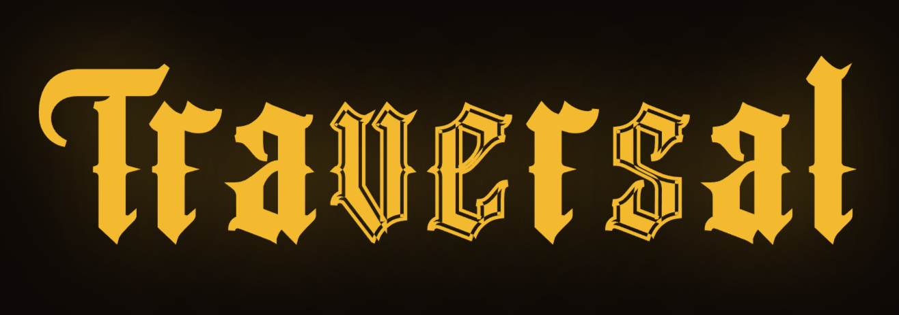
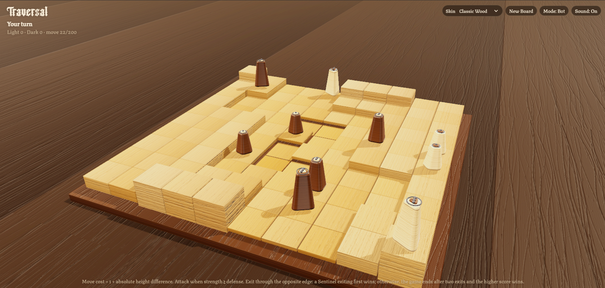
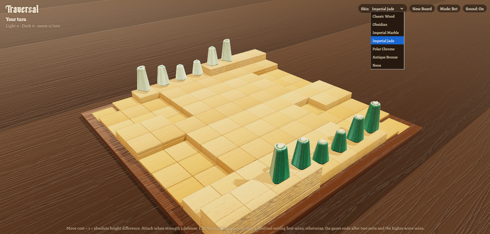

<div align="center">
  
  <p><strong>A 3D tactical board game built with JavaScript and Three.js.</strong></p>
  <p>Cross shifting terrain, coordinate attacks, and get your pieces safely off the opposite edge.</p>
  <p>
    
    
    
    
  </p>
</div>

---

## Preview

<table>
  <tr>
    <td align="center" width="50%">
      <strong>Classic board</strong><br />
      <sub>The board, terrain, and core game view</sub><br /><br />
      
    </td>
    <td align="center" width="50%">
      <strong>Piece skins</strong><br />
      <sub>Different materials and finishes for each side</sub><br /><br />
      
    </td>
  </tr>
</table>

## Inspiration

Traversal is inspired by [Traversal](https://traversalgame.com).

## Contents

- [Highlights](#highlights)
- [Getting started](#getting-started)
- [How to play](#how-to-play)
- [Piece classes](#piece-classes)
- [Movement and terrain](#movement-and-terrain)
- [Combat](#combat)
- [Exiting and winning](#exiting-and-winning)
- [Piece skins](#piece-skins)
- [Technical overview](#technical-overview)
- [Customization](#customization)
- [Troubleshooting](#troubleshooting)
- [License](#license)

## Highlights

- **A 10 × 10 3D board** with terrain heights generated for each new game and a rotationally mirrored layout.
- **Two ways to play:** challenge the built-in computer opponent or play locally with two human players.
- **Three distinct piece classes:** Explorer, Vanguard, and Sentinel, each with a unique movement budget and strength.
- **Seven detailed skins:** Classic Wood, Obsidian, Imperial Marble, Imperial Jade, Polar Chrome, Antique Bronze, and Neon.
- **Smooth game feedback:** animated movement, captures and exits, selection markers, visual effects, and synthesized sound effects.
- **Flexible input:** mouse, pen, and touch support for piece selection and camera rotation.
- **Adaptive rendering:** internal resolution can adjust to help balance sharpness and frame rate.
- **Responsive layout:** compact controls and safe-area spacing for mobile devices.
- **No build step:** no package manager or dependency installation is required.

## Getting started

### Requirements

- A modern browser with WebGL support, such as a recent version of Chrome, Edge, Firefox, or Safari.
- An internet connection to load Three.js and the fonts from their external CDNs.
- A local web server for the recommended setup. It avoids browser restrictions that may affect JavaScript modules opened directly from the file system.

### Run locally

1. Download or clone the project.
2. Open the project folder in your editor.
3. Start a local web server from that folder. In Visual Studio Code, you can install **Live Server**, right-click `index.html`, and select **Open with Live Server**.
4. Open the local URL shown by the server.

Alternatively, use Python if it is installed:

```bash
python -m http.server 8000
```

Then open <http://localhost:8000> in your browser.

## How to play

### Controls

| Action | How to do it |
| --- | --- |
| Select a piece | Click or tap one of your pieces. |
| Move, attack, or exit | Select a piece, then choose one of its highlighted destinations. |
| Rotate the camera | Drag across the board. |
| Start a new game | Select **New Board**. |
| Switch game mode | Select **Mode: Bot** or **Mode: 2 Players**. This starts a new game. |
| Toggle sound | Select **Sound: On** or **Sound: Off**. |
| Change the pieces' appearance | Choose a skin from the **Skin** menu. The selected skin applies to both sides. |

There is no separate move-confirmation step: selecting a highlighted destination performs the move.

### The board and starting pieces

- The board contains **10 rows and 10 columns**.
- Each side starts with six pieces: two Explorers, two Vanguards, and two Sentinels.
- The terrain has varying heights. A new height layout is generated when a new board is created.
- Player 1 is shown as **Light** and starts at one edge. Player 2 is shown as **Dark** and starts at the opposite edge.

## Piece classes

The movement range is the standard movement budget for orthogonal routes. Strength is used when calculating attacks and the points awarded for a successful exit.

| Piece | Movement range | Strength | Special behavior |
| --- | ---: | ---: | --- |
| **Explorer** | 5 | 1 | Can also move diagonally by one square or move two squares orthogonally if the intervening square is empty. These special moves do not use the standard route calculation. |
| **Vanguard** | 4 | 2 | Receives an additional +1 attack bonus when the attack route costs exactly 4 movement points. |
| **Sentinel** | 3 | 3 | If a Sentinel is the first piece to exit the board, its player wins immediately. |

## Movement and terrain

Normal movement follows orthogonally adjacent squares. Each step costs:

- **1 movement point** when the source and destination squares have the same height.
- **1 + the absolute height difference** when their heights differ.

A move is legal only if its complete route fits within the piece's movement budget. Occupied squares block normal routes. An enemy-occupied destination may be available as an attack if the combat calculation succeeds.

## Combat

When an attack is evaluated, the game calculates attack strength and defense:

- The attacking piece starts with its base strength.
- The attacker gains **+1** when it stands on higher terrain than the target, or **−1** when it stands on lower terrain.
- Friendly pieces adjacent to the target square support the attack by adding their strength to the attack total.
- Each defending-side piece adjacent to the target square adds **+1** to the defense total.
- A Vanguard attacking with a route cost of exactly **4** receives an additional **+1** attack bonus.

The attack succeeds when the resulting attack total is **greater than or equal to** the defense total. A successful attack removes the target piece.

## Exiting and winning

Pieces try to leave the board through the edge opposite their starting side. An exiting piece is removed from the board and awards points equal to its strength.

The game ends when one of the following occurs:

1. **A Sentinel exits first.** That player's victory is immediate.
2. **Two pieces have exited.** The game ends and the higher score wins; equal scores produce a draw.
3. **One side has no pieces left on the board.** The remaining score is adjusted using the highest-strength piece still on each side, if any, and the winner is determined by score.
4. **The 200-move limit is reached.** Scores determine the winner. If scores are tied, the game compares the remaining pieces' progress toward their respective exit edges, then their strengths.

If the active player has no legal move, that turn is skipped.

## Piece skins

Choose any of the seven skins from the **Skin** menu:

| Skin | Appearance |
| --- | --- |
| **Classic Wood** | Warm wood tones and polished accents. |
| **Obsidian** | Dark volcanic-glass surfaces with colored veins. |
| **Imperial Marble** | Light and dark marble with mineral veining and metallic details. |
| **Imperial Jade** | Jade-like surfaces, veins, and gold accents. |
| **Polar Chrome** | Reflective metallic surfaces with cool highlights. |
| **Antique Bronze** | Bronze tones with a patina effect. |
| **Neon** | Dark surfaces, luminous traces, and bright accents. |

The materials and texture details are generated in code; the game does not require external texture images for the pieces themselves.

## Technical overview

- **Rendering:** Three.js r128 is loaded from cdnjs. The scene uses WebGL, shadows, environment reflections, generated canvas textures, antialiasing, and a post-processing shader.
- **Resolution scaling:** the renderer starts at a device-pixel-ratio-aware resolution (up to 2×) and adjusts its internal resolution based on observed frame rate. Results depend on the browser and hardware.
- **Audio:** sound effects are synthesized in the browser. Audio may begin only after a user interaction, depending on browser autoplay policies.
- **Fonts:** the page requests Texturina from Google Fonts and Angel Wish from OnlineWebFonts. If those services are unavailable, the browser uses the configured fallback font families.
- **Game state:** the current game is held in memory. Reloading the page starts a fresh game; save-game persistence is not implemented.
- **Online services:** the game does not require an account or backend, but the HTML references external CDNs for Three.js and fonts.

## Customization

- **Rules and board:** edit the constants and rule functions near the beginning of `script.js`. Board setup, terrain generation, exits, and rendering also depend on the board size, so changing it may require coordinated changes.
- **Skins:** add or edit entries in the `PIECE_SKINS` object in `script.js`. Each skin defines materials for both players and supports body, inset, and accent finishes.
- **Layout:** adjust spacing, typography, and responsive behavior in `style.css`.
- **Interface:** edit visible labels and CDN references in `index.html`.

Reload the page after making changes.

## Troubleshooting

<details>
  <summary><strong>The board is blank or does not render</strong></summary>

  - Confirm that WebGL is supported and enabled in your browser.
  - Update your browser and graphics drivers if needed.
  - Open the browser developer console and check for JavaScript or WebGL errors.
  - Run the page through a local web server instead of opening `index.html` directly.
</details>

<details>
  <summary><strong>The fonts look different</strong></summary>

  The fonts are downloaded from external services. Check your internet connection, or remove/change the font links in `index.html`.
</details>

<details>
  <summary><strong>There is no sound</strong></summary>

  Interact with the page first, confirm that **Sound: On** is displayed, and check the browser tab and system volume.
</details>

<details>
  <summary><strong>Performance is low</strong></summary>

  Close other GPU-intensive tabs or applications. The game can reduce its rendering resolution when frame rates drop, but performance still depends on the browser and graphics hardware.
</details>

## License

This project is under [Mit License](LICENSE).

---

<div align="center">
  <sub>Traversal · 3D strategy, terrain, and tactical movement</sub>
</div>